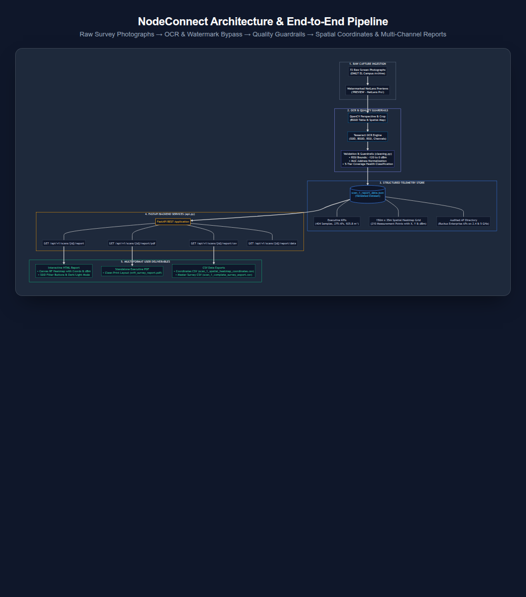

# NodeConnect

NodeConnect is a data-engineering + spatial-analytics + graph-analysis project for converting Wi-Fi survey photographs and exports into evidence-aware coverage insights and engineering reports.

## Project goal

The first working milestone is a reliable cleaning pipeline: ingest raw survey sources, normalize access-point metadata, validate signal strengths, flag suspicious rows, and produce an auditable quality report.

## Survey photo source data

The provided `DMGT EL` archive contains 72 JPEG photographs, not a PDF. The original images are stored in `data/raw/DMGT EL/`; they have not been OCR-processed or converted into observations. Keep them as source evidence and verify any values extracted from them before using those values for analysis. This folder is excluded from Git because it contains large source files.

## Suggested project structure

```text
NodeConnect/
├── backend/
│   ├── pyproject.toml
│   ├── src/
│   │   └── nodeconnect/
│   │       ├── __init__.py
│   │       ├── api.py
│   │       ├── cleaning.py
│   │       ├── config.py
│   │       └── ...
│   └── tests/
│       └── test_cleaning.py
├── data/
│   ├── raw/
│   └── processed/
├── frontend/
├── docs/
├── README.md
├── .gitignore
└── .vscode/
```

## Architecture & End-to-End Pipeline



Detailed technical documentation and Mermaid source code: [docs/architecture_workflow.md](docs/architecture_workflow.md).

## Milestone 1


The current implementation includes:

- A cleaning module with RSSI guardrail checks, identifier normalization, and quality labels.
- A FastAPI health endpoint, scan-quality endpoint, and HTML/JSON report endpoints.
- Reconstructed, watermark-free Wi-Fi engineering report (`reports/wifi_survey_report.html`) with one-click PDF export.
- Structured JSON survey telemetry extracted from NetLens photo previews (`data/processed/scan_1_report_data.json`).
- Pytest coverage for missing RSSI, out-of-range signal detection, and report data integrity.
- A sample CSV dataset for local experimentation.

## Local setup

```bash
cd NodeConnect/backend
python -m venv .venv
source .venv/bin/activate   # Windows: .venv\Scripts\activate
pip install -e .[dev]
pytest
```

## Run the API

```bash
cd NodeConnect/backend
python -m uvicorn nodeconnect.api:app --reload
```

Then visit:

- http://127.0.0.1:8000/api/v1/health
- http://127.0.0.1:8000/docs
- http://127.0.0.1:8000/api/v1/scans/scan_1/report (Interactive HTML Report + PDF & CSV Export)
- http://127.0.0.1:8000/api/v1/scans/scan_1/report/pdf (Direct PDF Download)
- http://127.0.0.1:8000/api/v1/scans/scan_1/report/csv (Complete CSV Export)
- http://127.0.0.1:8000/api/v1/scans/scan_1/report/csv?view=coordinates (Heatmap Coordinates CSV)
- http://127.0.0.1:8000/api/v1/scans/scan_1/report/data (Structured JSON Telemetry)

You can also directly open `reports/wifi_survey_report.html` in any web browser without running the server.

### Available Export Formats

1. **Standalone Executive PDF Report:**
   - Pre-rendered high-res PDF: `reports/wifi_survey_report.pdf`
   - In-browser clean PDF print via the **Download PDF** button with `@media print` layout.

2. **Interactive RF Spatial Heatmap:**
   - 150m × 35m coordinate grid with 210 physical sample points and ceiling AP locations.
   - Interactive hover tooltips showing precise `(X, Y)` meter coordinates, strongest SSID, and RSSI signal strength (dBm).
   - Network filter buttons to isolate SSIDs (`Jain_Student`, `Jain_Employee`, `Airtel`).

3. **CSV Data Exports:**
   - `reports/scan_1_spatial_heatmap_coordinates.csv`: 210 surveyed coordinate points with X/Y offsets, strongest network, and signal strength (dBm).
   - `reports/scan_1_complete_survey_export.csv`: Comprehensive master export bundling KPIs, coverage distribution, AP inventory, and coordinate telemetry.
   - `reports/scan_1_access_points.csv`: 18 enterprise APs with peak RSSI, band, channel, and vendor.
   - `reports/scan_1_waypoint_coordinates_rf.csv`: Multi-network RF snapshot at physical Waypoint #36 (X: 122.9m, Y: 26.6m).

## Optional OCR for survey photos

The `data/raw/DMGT EL/` folder contains screen photographs. OCR output is only candidate text and must be reviewed against each source image; it is not automatically accepted as survey data.

Install the optional Python dependencies in the backend environment:

```powershell
cd E:\NodeConnect\backend
.\.venv\Scripts\python.exe -m pip install -e ".[ocr]"
```

Install the Tesseract OCR application separately if it is not already installed. The command detects a Tesseract executable on `PATH` or in the usual Windows install locations. If it is installed elsewhere, set `TESSERACT_CMD` to its full executable path.

Run OCR from the backend folder:

```powershell
cd E:\NodeConnect\backend
.\.venv\Scripts\python.exe -m nodeconnect.ocr
```

The command writes `ocr_candidates.csv` and `ocr_candidates.txt` under `data/processed/DMGT EL/`. These generated files are excluded from Git. To intentionally replace previous results, add `--overwrite`.

## Next stages

1. Build the full cleaning and provenance pipeline.
2. Add graph analytics for routes and AP relationships.
3. Add FastAPI endpoints for clean datasets and report metadata.
4. Build the React dashboard and PDF export.

The guiding principle remains: every visual result must be traceable to validated data, and every statistic must be testable.
# node-connect
