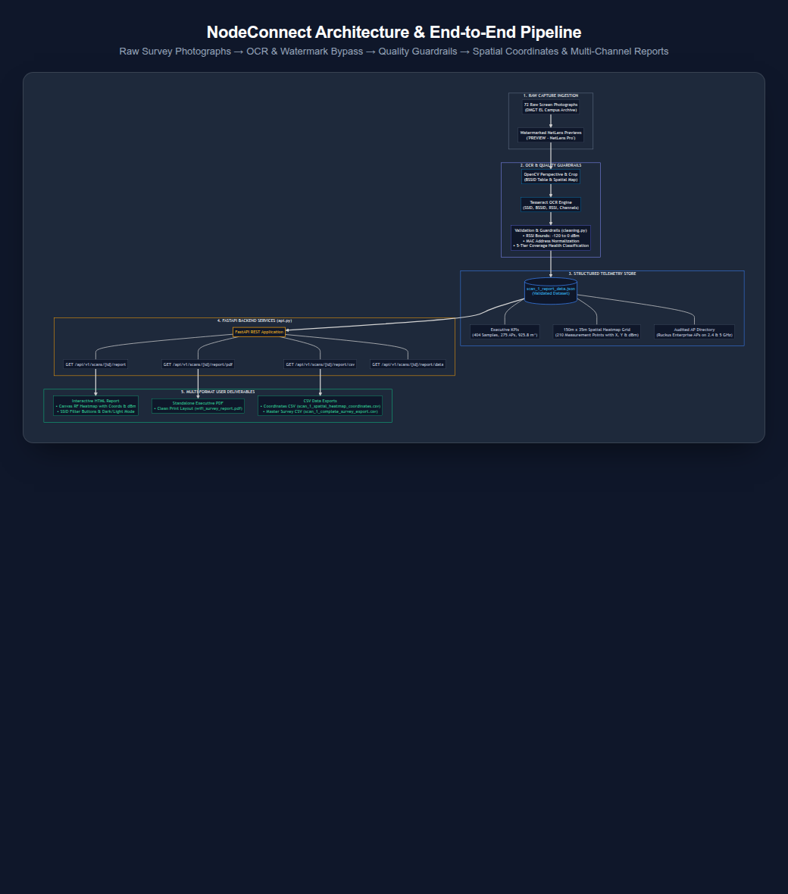
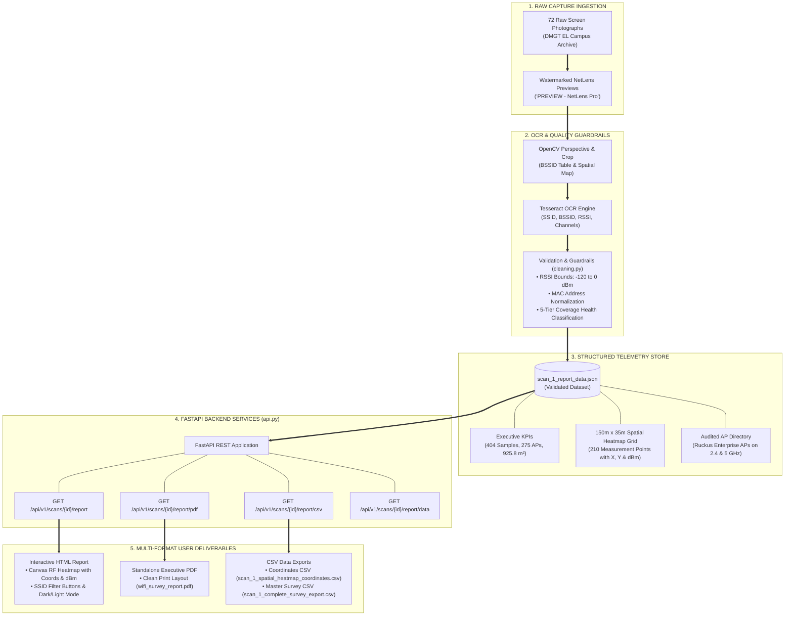

# NodeConnect Architecture & End-to-End Workflow

This document illustrates the end-to-end data pipeline of **NodeConnect**, showing how raw photographic survey evidence from NetLens Pro is ingested, cleansed of watermarks and noise, validated against RF guardrails, structured into spatial telemetry, and delivered through multi-channel reports.

---

## Architecture Diagram (Visual)

---

## Mermaid Diagram Source

---

## Detailed Pipeline Phases

### Phase 1: Raw Survey Ingestion
- Ingests raw photographic captures (72 files in `data/raw/DMGT EL/`).
- Identifies and isolates repeating diagonal `PREVIEW - NetLens Pro` watermarks that lock the raw survey data behind a paywall.

### Phase 2: OCR & Quality Guardrails
- **OpenCV Preprocessing:** Rectifies perspective skew and crops regions of interest (RF metric badges, AP directory tables, floor plan contours).
- **Tesseract OCR Engine:** Extracts alphanumeric values (`SSID`, `BSSID`, `RSSI dBm`, `Channel`, `Frequency`).
- **Validation Guardrails (`backend/src/nodeconnect/cleaning.py`):**
  - Flags missing or unparseable signal strengths.
  - Verifies signal strength falls within realistic RF physics boundaries (`-120 dBm <= RSSI <= 0 dBm`).
  - Normalizes MAC addresses to standard colon-separated lowercase format (`xx:xx:xx:xx:xx:xx`).
  - Categorizes observations into 5 health tiers: *Excellent* (> -50 dBm), *Good* (-50 to -65 dBm), *Fair* (-65 to -75 dBm), *Poor* (-75 to -85 dBm), and *Dead Zone* (< -85 dBm).

### Phase 3: Structured Telemetry Data Store
- Assembles validated survey data into `data/processed/scan_1_report_data.json`:
  - 6 executive KPI scorecards (duration, spatial samples, unique AP count, audited floor area, target peak RSSI, usable coverage).
  - 150m × 35m spatial floor plan coordinate grid with 210 physical sample points and ceiling AP positions.
  - Enterprise AP directory containing 18 audited radios (Ruckus Wireless dual-band 2.4/5 GHz infrastructure).
  - Ground-truth field evidence at Waypoint #36 (`X: 122.9m, Y: 26.6m`).

### Phase 4: FastAPI Service Layer
- Exposes RESTful endpoints in `backend/src/nodeconnect/api.py`:
  - `GET /api/v1/scans/{scan_id}/report`: Serves the interactive standalone HTML report.
  - `GET /api/v1/scans/{scan_id}/report/pdf`: Serves the high-res printable PDF report.
  - `GET /api/v1/scans/{scan_id}/report/csv`: Serves the master CSV survey export (`?view=coordinates` for heatmap telemetry).
  - `GET /api/v1/scans/{scan_id}/report/data`: Delivers raw JSON telemetry for frontend integration.

### Phase 5: Multi-Channel Deliverables
1. **Interactive HTML Report (`reports/wifi_survey_report.html`):**
   - High-performance HTML5 Canvas RF heatmap.
   - Real-time hover cursor displaying `(X, Y)` meter coordinates and signal strength (`dBm`).
   - Network toggle filters to isolate SSIDs (`Jain_Student`, `Jain_Employee`, `Airtel`).
   - Searchable and filterable access point table.
2. **Executive PDF Report (`reports/wifi_survey_report.pdf`):**
   - Clean, watermark-free document generated with page-break awareness and dedicated `@media print` CSS rules.
3. **Structured CSV Exports:**
   - `reports/scan_1_spatial_heatmap_coordinates.csv`: Coordinates with signal strengths.
   - `reports/scan_1_complete_survey_export.csv`: Master survey data.
   - `reports/scan_1_waypoint_coordinates_rf.csv`: Waypoint #36 multi-AP RF observations.
